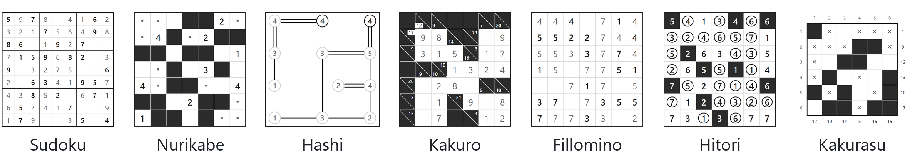

# pencil-puzzles

[](https://pypi.org/project/pencil-puzzles/)
[](https://github.com/emieks/pencil-puzzles/actions/workflows/ci.yml)
[](LICENSE)

Generate, solve and rate pencil puzzles in Python.

Every puzzle has exactly one solution, and a brute-force solver proves it.
Its difficulty depends on how a person would solve it: the hardest technique
the puzzle needs decides its level. Ask for an expert sudoku and you get one
that needs a technique such as an X-wing.

<p>
  <picture>
    <source media="(prefers-color-scheme: dark)" srcset="docs/images/genres-dark.png">
    
  </picture>
</p>

**[Play them in your browser →](https://pencil-puzzles.org/)** ·
**[Documentation](https://pencil-puzzles.org/docs/)**

## Quick start

```sh
pip install pencil-puzzles
```

Python 3.10 or newer, on Windows, macOS and Linux.

Generate a hard sudoku and print it:

```python
import pencil_puzzles as pp

game = pp.generate("sudoku", difficulty="hard", seed=7)
print(game.puzzle)
```

```text
. 1 . | 4 . . | 5 . 6
. . . | 9 . . | . . .
9 . . | . . 6 | 1 2 4
------+-------+------
5 . 7 | . . . | 9 . .
8 . . | . . . | . . 5
. . 1 | . . . | 2 . 7
------+-------+------
4 6 9 | 5 . . | . . 1
. . . | . . 1 | . . .
1 . 3 | . . 7 | . 5 .
```

The same seed always gives the same puzzle; leave it out for a new one each
time. Every puzzle comes with its solution and rating. Clues and solutions
are tuples of rows, with 0 for an empty cell:

```python
game.rating.techniques  # ('claiming', 'hidden_pair', ..., 'pointing')
game.puzzle.clues[0]    # (0, 1, 0, 4, 0, 0, 5, 0, 6)
game.solution.cells[0]  # (7, 1, 2, 4, 8, 3, 5, 9, 6)
game.puzzle.id          # 'sudoku:9x9:.1.4..5.6...' — save or share it

pp.solve(game.puzzle) == game.solution  # True
```

Every genre takes a size as `(rows, columns)`. Without one, you get the
genre's [standard size](#genres), such as 9×9 for sudoku:

```python
pp.generate("sudoku", (4, 4))
pp.generate("nurikabe", (7, 7), difficulty="medium")
```

Other genres work the same way. [Each genre's page](#genres) shows its values.

## The library

Six functions cover everything:

```python
pp.generate(genre, shape=None, *, difficulty=None, seed=None)  # a new puzzle, its solution and rating
pp.solve(puzzle)                                               # the solution, proven to be the only one
pp.rate(puzzle)                                                # the level and the techniques it needs
pp.check(puzzle, answer, *, finished=False)                    # every rule the answer breaks
pp.hint(puzzle, answer=None)                                   # the next step from the answer so far
pp.genres()                                                    # the genres you can use
```

- **`genre`**: a name from `pp.genres()`, such as `"sudoku"`
- **`shape`**: `(rows, columns)`, or the genre's [standard size](#genres) if
  left out
- **`difficulty`**: `"easy"`, `"medium"`, `"hard"` or `"expert"`, or any level
  if left out
- **`seed`**: a number that fixes the puzzle, or random if left out
- **`answer`**: a player's grid so far, as `pp.Solution(genre, rows)`

Every function also takes `limits` and `cancel` to bound or stop long calls.

Save a puzzle with `puzzle.to_text()` or share it as `puzzle.id`. The
[documentation](https://pencil-puzzles.org/docs/) has every option.

## Genres

| Genre | Goal | Standard size | Largest |
| --- | --- | --- | --- |
| [Fillomino](https://pencil-puzzles.org/docs/genres/fillomino/) | Divide the grid into regions whose cells hold the region's size; same-size regions never share a side. | 10×10 | 10×10 |
| [Hashi](https://pencil-puzzles.org/docs/genres/hashi/) | Connect all islands with straight bridges that never cross, giving each island as many bridges as its number. | 10×10 | 15×15 |
| [Hitori](https://pencil-puzzles.org/docs/genres/hitori/) | Shade cells so no unshaded number repeats in a row or column; shaded cells never share a side and unshaded cells stay connected. | 8×8 | 12×12 |
| [Kakurasu](https://pencil-puzzles.org/docs/genres/kakurasu/) | Shade cells so each row and column clue is the sum of its shaded cells' positions. | 7×7 | 32×32 |
| [Kakuro](https://pencil-puzzles.org/docs/genres/kakuro/) | Fill the white cells with digits 1–9 so each run adds up to its clue without repeating a digit. | 10×10 | 16×16 |
| [Nurikabe](https://pencil-puzzles.org/docs/genres/nurikabe/) | Shade a connected sea, leaving islands the size of their numbers and no shaded 2×2 block. | 10×10 | 10×10 |
| [Sudoku](https://pencil-puzzles.org/docs/genres/sudoku/) | Fill rows, columns and boxes with each digit exactly once. | 9×9 | 9×9 (also&nbsp;4×4) |

Each genre's page has its rules, techniques and formats.

## How difficulty works

The solver works like a person: at each step it uses the simplest technique
that makes progress. The hardest technique it needs sets the level.

| Level | What it takes |
| --- | --- |
| Easy | Direct deductions from a single rule or clue |
| Medium | Standard combinations and small patterns |
| Hard | Larger patterns, or short "what if this cell were…" chains |
| Expert | Several patterns combined, and longer chains |

The full method is in [how puzzles are rated](https://pencil-puzzles.org/docs/difficulty/).

## Beyond Python

**In the browser.** The [web app](https://pencil-puzzles.org/)
lets you play or solve every genre.

**On the command line.** With Rust 1.88 or newer:

```sh
cargo install pencil-puzzles-cli
pencil-puzzles generate nurikabe --shape 7x7 --difficulty hard --format pretty
```

Run `pencil-puzzles --help` to see every command.

**In Rust.** Add it with `cargo add pencil-puzzles`. The engine is a Rust
workspace in [`crates/`](crates).

## Contributing

Contributions of every size are welcome. Start with
[CONTRIBUTING.md](CONTRIBUTING.md).

## License

[MIT](LICENSE)
